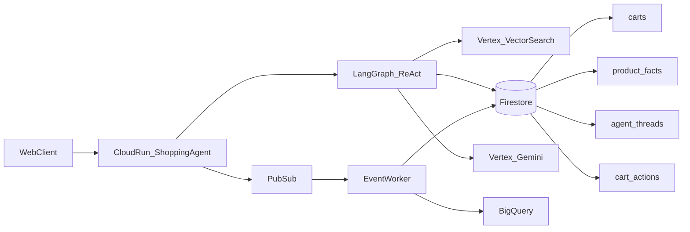

# Shopping Chat Agent Architecture

High-traffic serving path for the RecommendAI Shopping Chat Agent on GCP project `shopping-agent-513607`.

## Overview

## Responsibilities

| Layer | Role |
|-------|------|
| Cloud Run | Stateless HTTP edge; concurrency ~80, min instances for warm LangGraph/Vertex clients |
| LangGraph | Process-cached ReAct agent on Vertex Gemini; tools for search, deals, cart proposals |
| Firestore | Hot path: carts, cart_actions, product_facts, agent_threads (chat resume) |
| Vector Search / FAISS | Catalog retrieval (dense embeddings); never trusts index prices alone |
| Pub/Sub | Async commerce + pricing + agent turn events |
| BigQuery | Analytics sink for cart/agent/catalog events |
| SQLite | Catalog, users, recommenders, local/test fallback when `FIRESTORE_ENABLED=0` |

## Firestore collections

- `carts/{user_id}` — `items` map of `{product_id, quantity, updated_at}`
- `cart_actions/{action_id}` — proposed / applied / rejected agent cart changes
- `product_facts/{warehouse_id}_{product_id}` — live `price`, `list_price`, `stock_qty`
- `agent_threads/{thread_id}` — durable chat messages (`thread_id = user_{id}`)
- `chat_memory/{user_id}/chunks/{chunk_id}` — per-member chat RAG embeddings
- `wishlists/{user_id}` — member wishlist items

Facts reads use a short in-process TTL cache (~8s) to absorb deal-search fanout.
Before each agent turn, similar past chat chunks are retrieved and injected into the system prompt; `recall_past_chats` can fetch more on demand.

## Request path (chat turn)

1. Client posts `/api/chat` with `user_id` + message.
2. Agent sets per-request tool context, loads Firestore thread history if the in-process checkpointer is cold.
3. LangGraph invokes tools (Vector Search + facts overlay + cart store).
4. Cart mutations are **proposed** only; member confirms via `/api/cart/actions/.../confirm`.
5. Turn is published to Pub/Sub; messages persisted to `agent_threads`.

## Price / stock path

1. Admin or upstream system publishes `pricing.price-changed` / `inventory.stock-changed`.
2. Push subscription hits `/api/events/pubsub`.
3. Worker upserts Firestore `product_facts` (and optionally BigQuery).
4. Next deals/search/cart read overlays live facts before scoring.

## Feature flags

- `FIRESTORE_ENABLED=1` — hot path on Firestore
- `PUBSUB_ENABLED`, `BQ_ENABLED` — event fan-out / analytics
- `USE_LANGGRAPH=1` — ReAct orchestrator (legacy OpenAI-shaped loop for tests)
- `VECTOR_SEARCH_*` — managed retrieval; FAISS Vertex index is the fallback

## Out of scope (current)

- Full product catalog in Firestore
- Redis / Memorystore (TTL cache is in-process)
- Dataflow replacing the Cloud Run push worker
